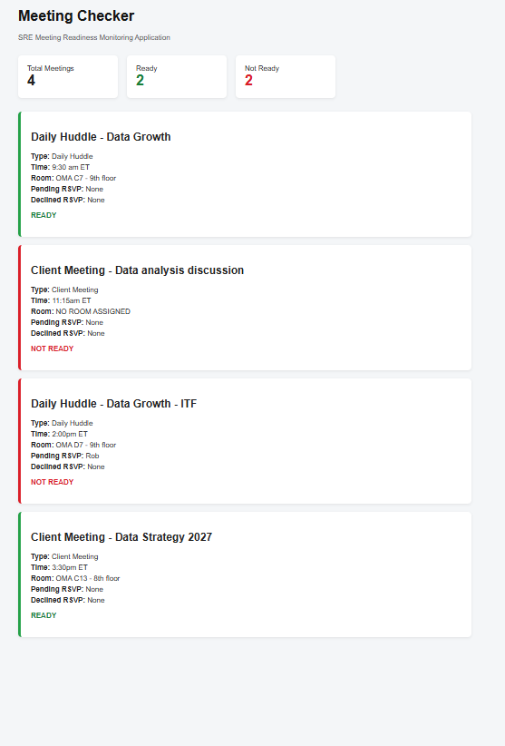
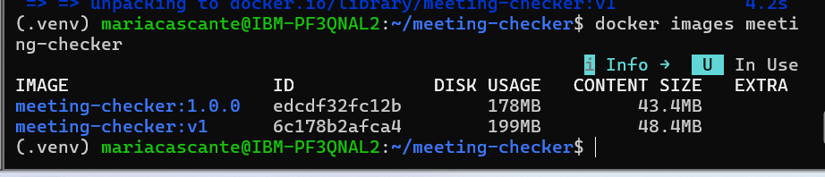
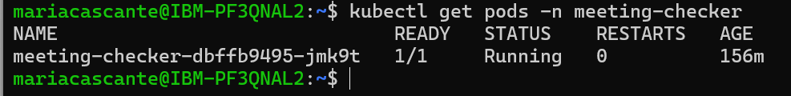
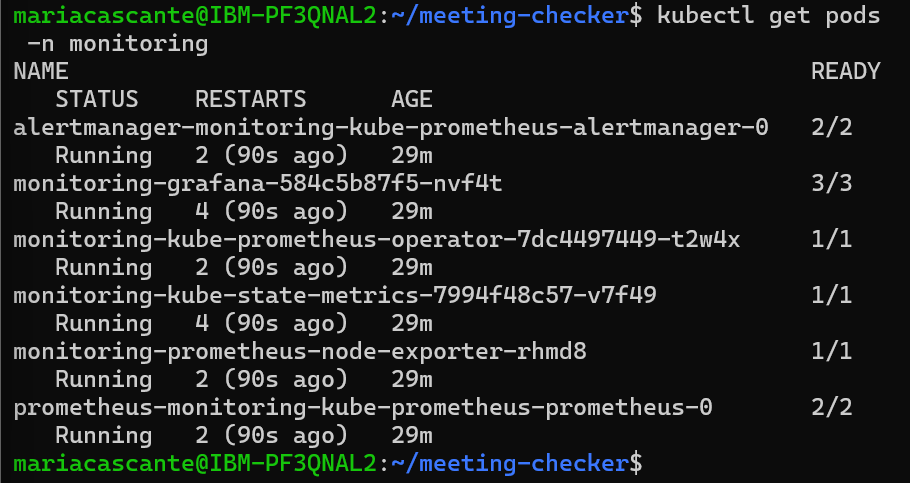
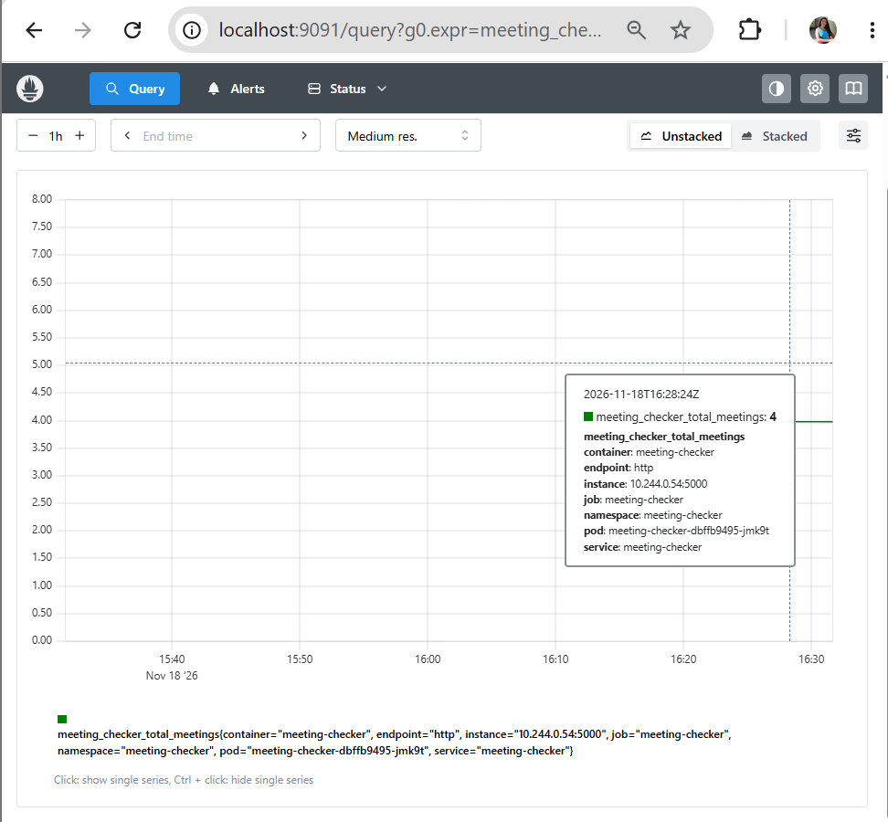
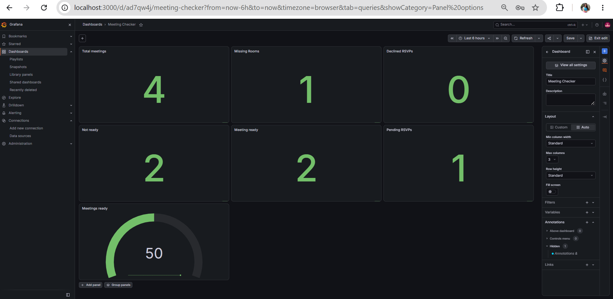
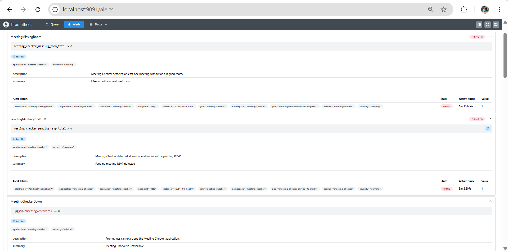
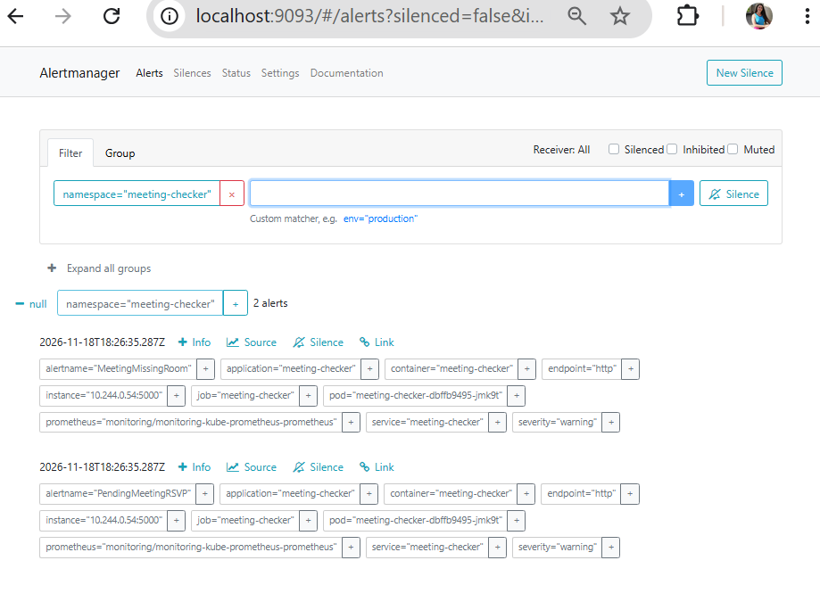

Meeting Checker
Meeting Checker is an application for the SRE Academy Final Project.
This app checks the meetings included in it to identify if they are ready, or need further action. 
A meeting is READY when:
	• It has a room.
	• There are no pending RSVPs.
	• Nobody declined the meeting.
If one of these conditions is not completed, the meeting is not ready.
App developed in the Ubuntu terminal with help from Copilot.

The project includes the tools studied in the academy:
	• Python
	• Flask
	• Docker
	• Kubernetes
	• Minikube
	• Prometheus
	• Grafana
	• Alertmanager
	• Helm
	• GitHub
	
Deployment of the application:
Meeting Checker get the infromation from the meetings.json file, and it should contain 4 meetings:
	• 2 ready meetings
	• 2 not ready meetings
	• 1 missing room
	• 1 pending RSVP
	• 0 declined RSVPs
Meeting Checker Application

Docker
The docker image is: docker build -t meeting-checker:v1 .

To run it:
docker run -d --name meeting-checker -p 5000:5000 meeting-checker:v1

The application open in the browser by pasting: 
http://localhost:5000

Docker Image

Kubernetes
To start Minikube:
minikube start --driver=docker
To create the namespace:
kubectl create namespace meeting-checker
To build the image for the Meeting checker:
minikube image build -t meeting-checker:v1 .
To deploy Meeting Checker:
kubectl apply -f kubernetes/deployment.yaml
kubectl apply -f kubernetes/service.yaml
To Check the Pod:
kubectl get pods -n meeting-checker

Kubernetes

Prometheus, Grafana and Alertmanager
The monitoring tools are installed with Helm.
helm repo add prometheus-community https://prometheus-community.github.io/helm-charts
helm repo update
To create the monitoring namespace:
kubectl create namespace monitoring
To install the monitoring stack:
helm install monitoring prometheus-community/kube-prometheus-stack \
  --namespace monitoring
The monitoring stack includes:
	• Prometheus
	• Grafana
	• Alertmanager
	
Monitoring

Prometheus
The Service Monitor can be deployed with:
kubectl apply -f kubernetes/servicemonitor.yaml
For example, this query:
meeting_checker_total_meetings
shows the total number of meetings.

Prometheus

Grafana
The dashboard shows:
	• Total Meetings
	• Ready Meetings
	• Not Ready Meetings
	• Meeting Readiness
	• Missing Rooms
	• Pending RSVPs
	• Declined RSVPs
The dashboard file is saved in:
monitoring/grafana-dashboard.json

Grafana Dashboard

Alerts
Prometheus has three alert rules:
	• MeetingMissingRoom
	• PendingMeetingRSVP
	• MeetingCheckerDown
	
The rules are located in:
monitoring/prometheus-rules.yaml
They can be deployed with:
kubectl apply -f monitoring/prometheus-rules.yaml

Prometheus Alerts

Alertmanager
Alertmanager receives the alerts created by Prometheus.
For the test, the sample data has one meeting without a room and one pending RSVP. This makes it possible to see the alerts working.

Alertmanager

Maria Laura Cascante Fallas
SRE Academy Final Project
